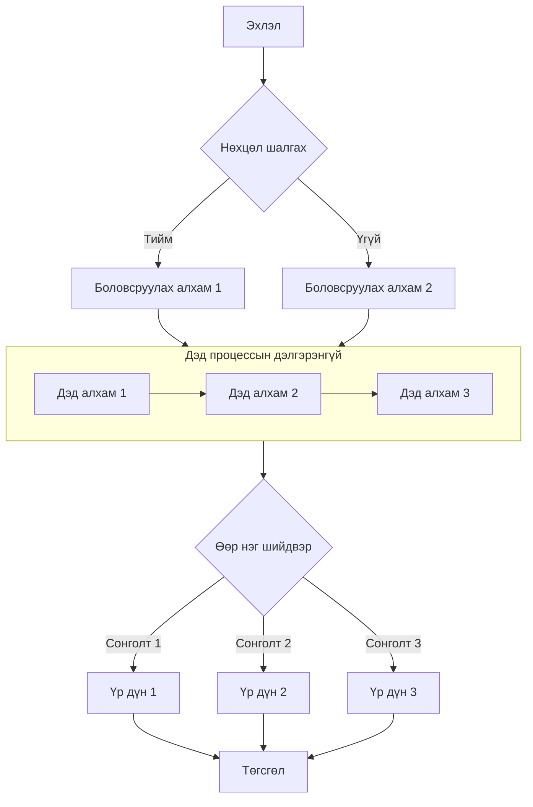

## Энэ өгүүллийг амжилттай тайлсан!

Хэрэв та энэ агуулгыг харж байгаа бол нууц үг зөв оруулсан бөгөөд өгүүлэл амжилттай тайлагдсан гэсэн үг.

### Функцын тайлбар

- **Бүтээх үеийн шифрлэлт**: Өгүүллийн агуулгыг бүтээх үед AES-256-GCM алгоритмаар шифрлэдэг тул хуудасны эх кодонд ямар ч тодорхой текст агуулагдахгүй.
- **Клиент талын тайлалт**: Зочин зөв нууц үг оруулсны дараа хөтөч Web Crypto API-аар локал байдлаар тайлна.
- **Сессийн кэш**: Нэг хөтчийн сессын дотор нууц үг `sessionStorage`-д кэшлэгддэг тул хуудсыг дахин ачаалахад дахин оруулах шаардлагагүй.
- **Хаахад хүчингүй болно**: Хөтчийг хаасны дараа кэш арилдаг тул дахин зочлоход нууц үгийг дахин оруулах шаардлагатай.

> Нууц үг нь `123456` бөгөөд зөвхөн туршилтад зориулагдсан.

## Зураг


## GitHub репозиторийн карт

::github{repo="CuteLeaf/Firefly"}

## Анхааруулах хайрцаг

> [!NOTE] NOTE
> Хэрэглэгчийн анхаарах ёстой мэдээллийг онцлон харуулна.

> [!TIP] TIP
> Хэрэглэгчид илүү амжилттай ажиллахад туслах нэмэлт мэдээлэл.

> [!NOTE] Гарын үсгийн гарчиг
> Энэ бол өөрийн гарчигтай жишээ юм.

## Математик томьёо
### Мөрийн томьёо (Inline)

Эйлерийн томьёо $e^{i\pi} + 1 = 0$ нь математикийн хамгийн гоёмсог томьёоны нэг юм.

Масс-энергийн тэгшитгэл $E = mc^2$ нь ч бас өргөн танигдсан.

### Блок томьёо (Block)

Блок томьёог хоёр `$$` тэмдгээр хүрээлж бичих ба голлосон байдлаар харагдана.

$$
\int_{-\infty}^{\infty} e^{-x^2} dx = \sqrt{\pi}
$$

$$
x = \frac{-b \pm \sqrt{b^2 - 4ac}}{2a}
$$

### Химийн тэгшитгэл (Chemical Equations)

$$
\ce{CH4 + 2O2 -> CO2 + 2H2O}
$$

## Кодын блок
#### Энгийн синтакс тодотгол

```js
console.log('Энэ код синтакс тодотголтой!')
```

#### ANSI escape дарааллыг дүрслэх

```ansi
ANSI colors:
- Regular: Red Green Yellow Blue Magenta Cyan
- Bold:    Red Green Yellow Blue Magenta Cyan
- Dimmed:  Red Green Yellow Blue Magenta Cyan

256 colors (showing colors 160-177):
160 161 162 163 164 165
166 167 168 169 170 171
172 173 174 175 176 177

Full RGB colors:
ForestGreen - RGB(34, 139, 34)

Text formatting: Bold Dimmed Italic Underline
```


## Урсгал диаграм


