## Markdown дахь Mermaid диаграмын бүрэн гарын авлага

Энэ өгүүлэл нь Markdown баримт бичигт Mermaid ашиглан урсгал диаграм, дарааллын диаграм, ER диаграм, класс диаграм, төлөвийн диаграм, XY диаграм, Gantt диаграм, сэтгэлгээний зураг зэрэг олон төрлийн нийлмэл диаграм хэрхэн бүтээхийг танилцуулна.

> Mermaid диаграмыг [Merman](https://github.com/Latias94/merman) хэрэгжүүлсэн. Firefly нь Astro-ийн бүтээх үе шатанд гэрэл болон харанхуй гэсэн хоёр багц статик SVG үүсгэдэг тул хөтөч дотор Mermaid-ийн дүрслэх runtime ачаалах шаардлагагүй. [Merman Playground](http://frankorz.com/merman/) руу орж синтаксийг шууд засаж, дүрслэлийн үр дүнг урьдчилан үзэж болно.

## Урсгал диаграмын жишээ

Урсгал диаграм нь урсгал эсвэл алгоритмын алхмыг илэрхийлэхэд маш тохиромжтой.


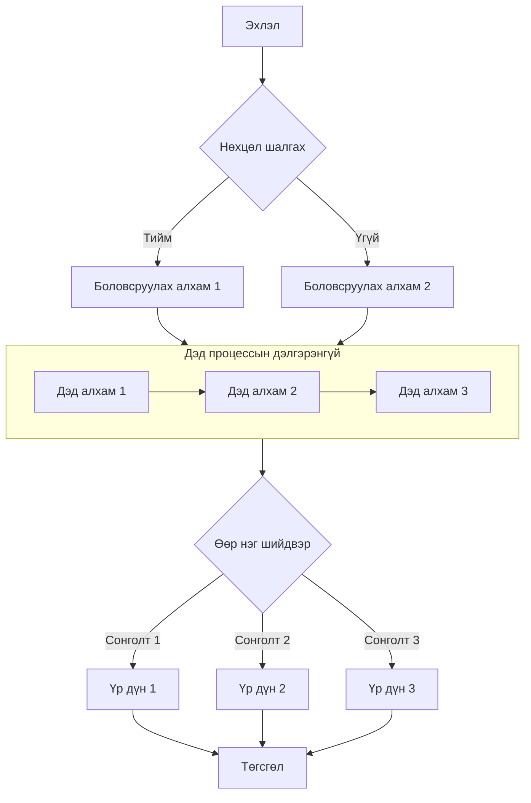

## Дарааллын диаграмын жишээ

Дарааллын диаграм нь объектуудын хоорондын цаг хугацааны харилцан үйлчлэлийг харуулна.

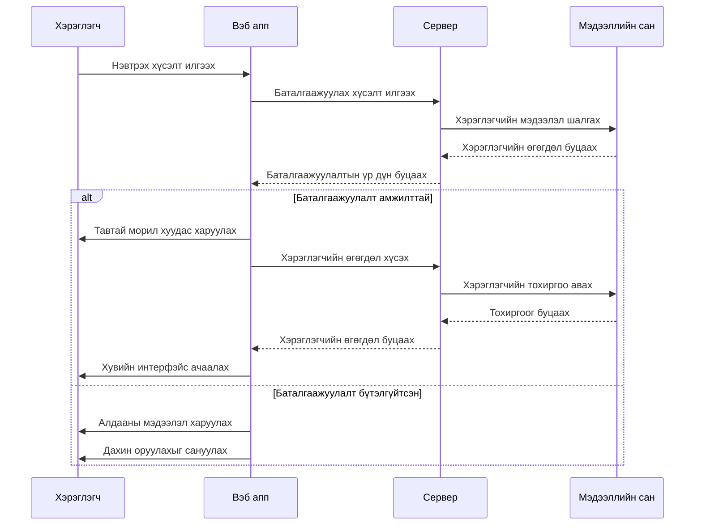

## ER диаграмын жишээ

ER диаграм (entity relationship diagram) нь мэдээллийн сангийн бүтцийг илэрхийлэхэд маш тохиромжтой.

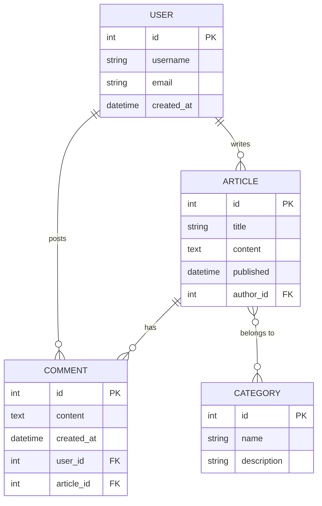

## Класс диаграмын жишээ

Класс диаграм нь системийн статик бүтцийг, үүний дотор класс, шинж чанар, метод болон тэдгээрийн харилцааг харуулна.

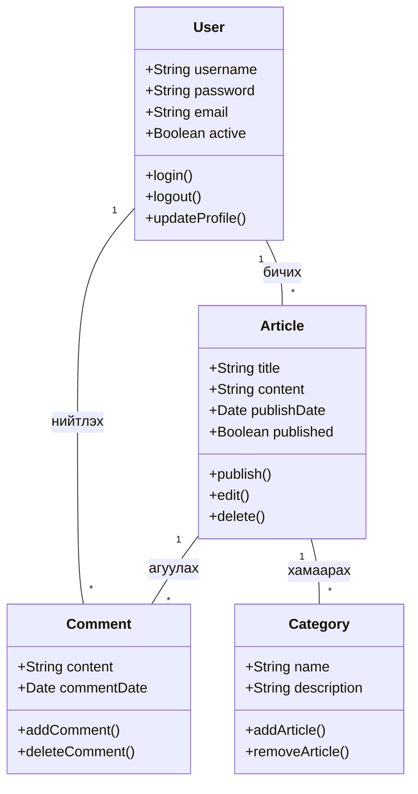

## Төлөвийн диаграмын жишээ

Төлөвийн диаграм нь объектын амьдралын мөчлөгт дамждаг төлөвийн дарааллыг харуулна.

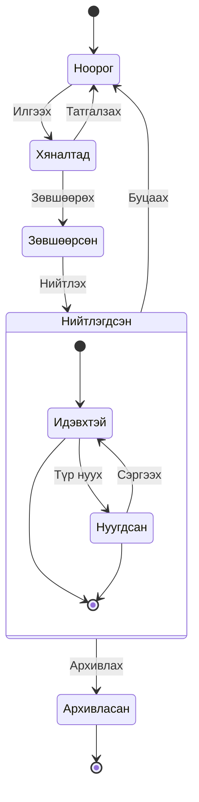

## XY диаграмын жишээ

XY диаграм нь чиг хандлага болон харьцуулах өгөгдлийг харуулахад маш тохиромжтой.

```mermaid
xychart-beta
    title "Сарын зочлолтын чиг хандлага"
    x-axis [1-р сар, 2-р сар, 3-р сар, 4-р сар, 5-р сар, 6-р сар]
    y-axis "Зочлолт" 0 --> 5000
    bar [2500, 3200, 4100, 3800, 4500, 4800]
    line [2500, 3200, 4100, 3800, 4500, 4800]
```

## Дугуй диаграмын жишээ

Дугуй диаграм нь хэсэг бүрийн бүхэлд эзлэх хувийг шууд харуулахад тохиромжтой.

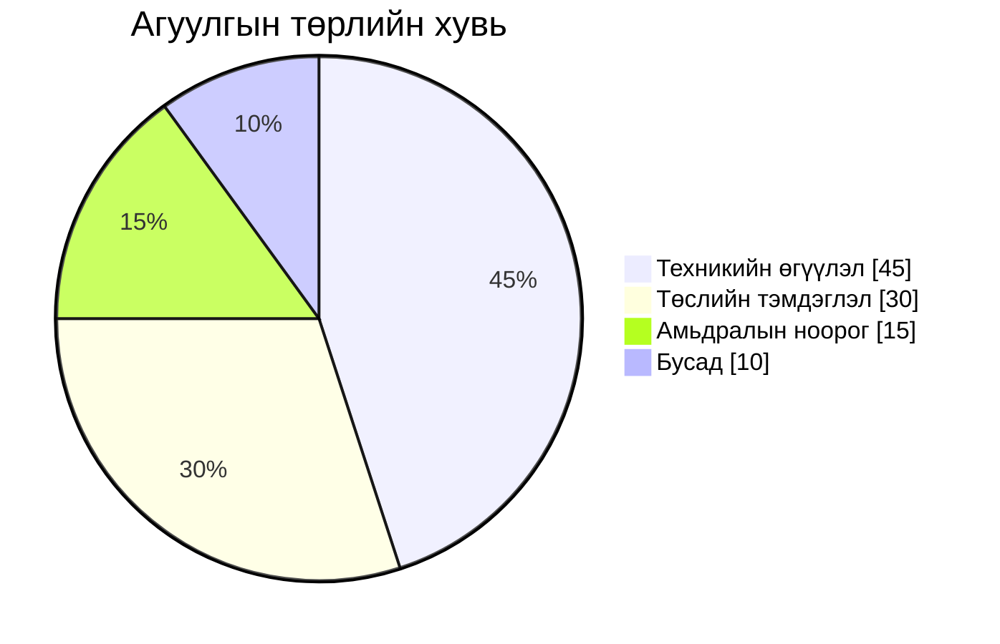

## Gantt диаграмын жишээ

Gantt диаграм нь төслийн үе шат, даалгаврын хамаарал болон одоогийн явцыг цаг хугацааны тэнхлэгээр харуулна.

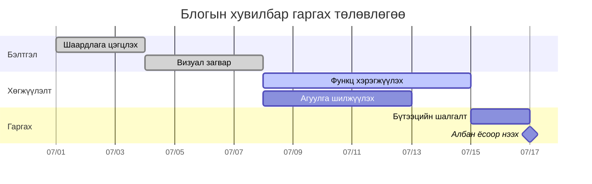

## Сэтгэлгээний зургийн жишээ

Сэтгэлгээний зураг нь сэдвийн шатлал болон мэдлэгийн бүтцийг цэгцлэхэд тохиромжтой.

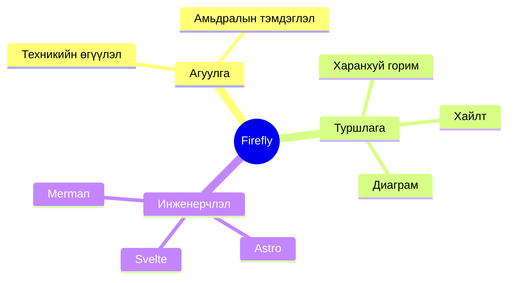

## Цаг хугацааны шугамын жишээ

Цаг хугацааны шугамыг төслийн чухал үйл явдлыг он эсвэл үе шатаар харуулахад ашиглана.

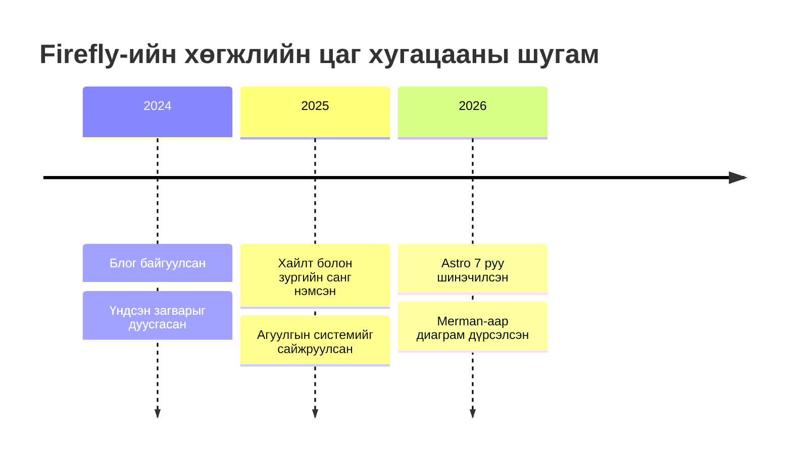

## Хэрэглэгчийн аяллын диаграмын жишээ

Хэрэглэгчийн аяллын диаграм нь хэрэглэгчийн өөр өөр үе шатны үйлдэл болон туршлагын үнэлгээг дүрсэлж чадна.

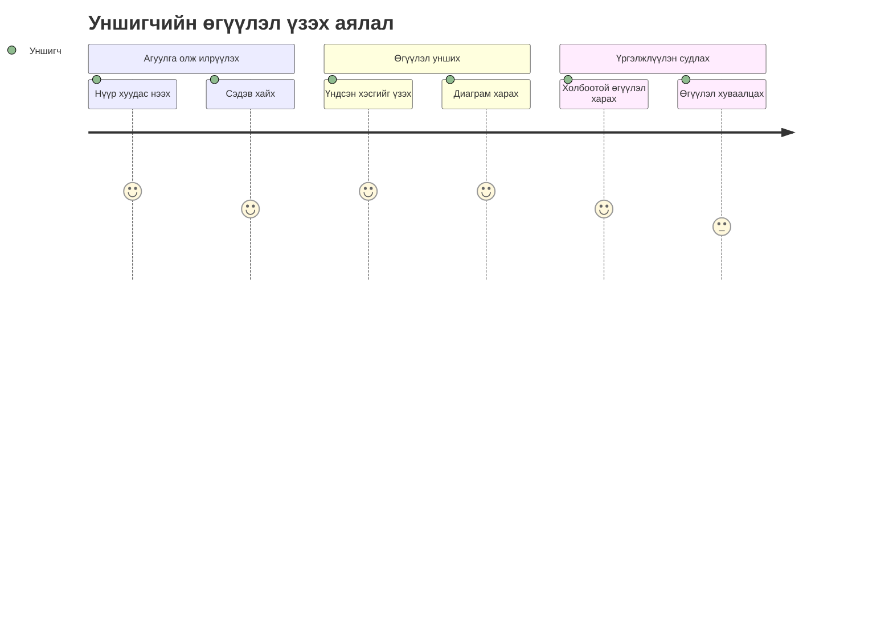

## Git диаграмын жишээ

Git диаграм нь салбар, commit болон merge-ийн түүхийг тодорхой харуулна.

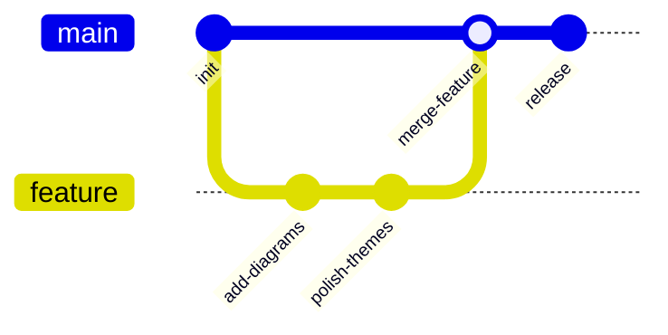

## Kanban жишээ

Kanban нь даалгавруудын ажлын үе шатуудын хоорондох хуваарилалтыг харуулахад тохиромжтой.

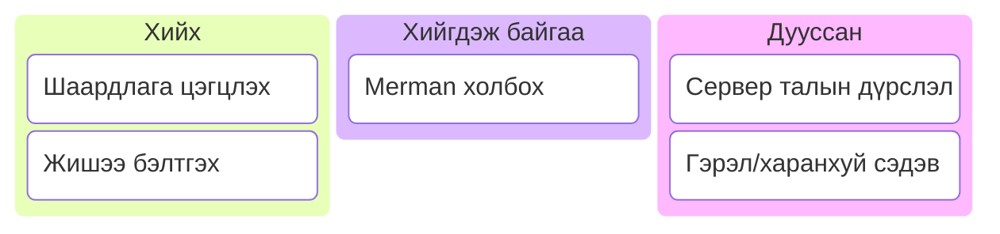

## Sankey диаграмын жишээ

Sankey диаграм нь шугамын өргөнөөр дамжуулан урсгалын зангилаануудын хоорондох чиглэлийг харуулна.

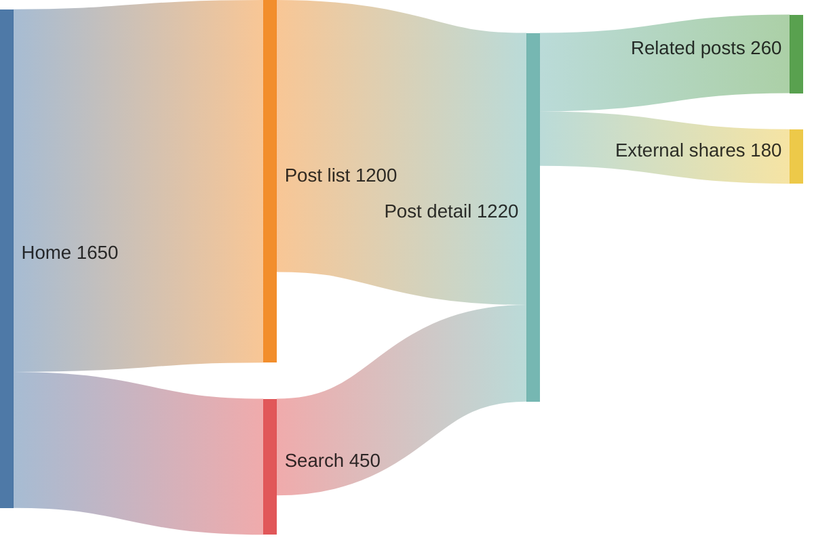

## Дүгнэлт

Mermaid нь Markdown баримт бичигт олон төрлийн диаграм бүтээх хүчирхэг хэрэгсэл юм. Энэ өгүүлэл урсгал диаграм, дарааллын диаграм, ER диаграм, класс диаграм, төлөвийн диаграм, XY диаграм, дугуй диаграм, Gantt диаграм, сэтгэлгээний зураг, цаг хугацааны шугам, хэрэглэгчийн аяллын диаграм, Git диаграм, Kanban болон Sankey диаграмыг танилцууллаа. Эдгээр диаграм нь нийлмэл ойлголт, урсгал болон өгөгдлийн бүтцийг илүү тодорхой илэрхийлэхэд тусална.

Mermaid ашиглахын тулд кодын блок дотор mermaid хэлийг зааж, товч текстийн синтаксоор диаграмыг тодорхойлоход хангалттай. Диаграм нь бүтээх үед SVG болж автоматаар дүрслэгдэх тул клиент талын JavaScript ачаалах шаардлагагүй.

[Merman Playground](http://frankorz.com/merman/) руу орж илүү олон синтаксийг туршиж, диаграмын кодоо өгүүлэлд буулгаж болно.
