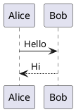
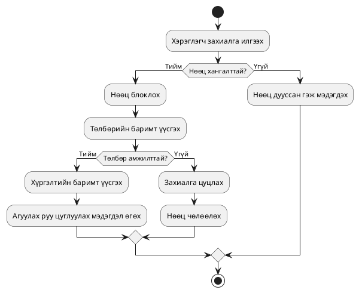
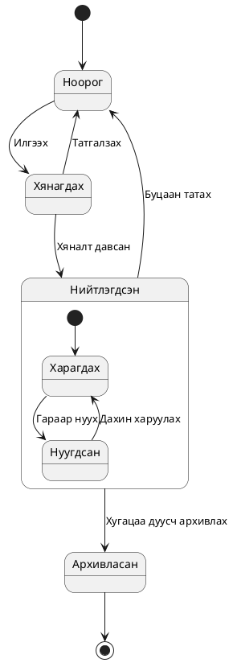
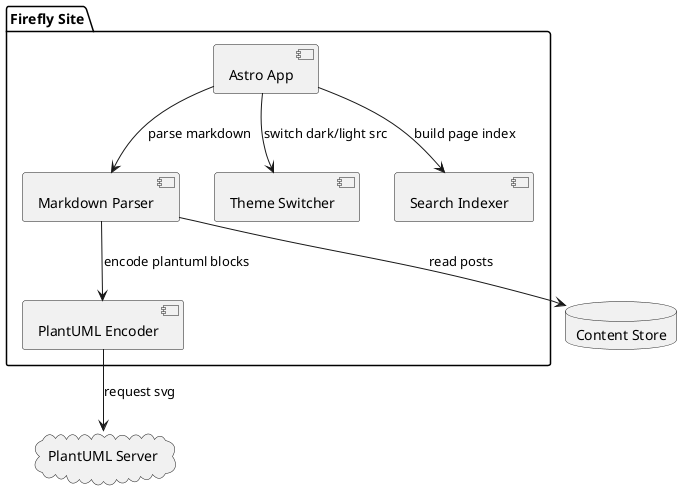
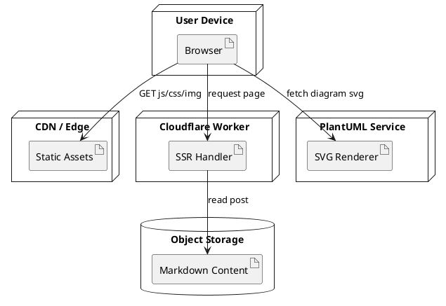
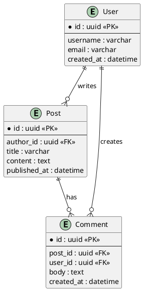

## Markdown дахь PlantUML диаграмын гарын авлага

PlantUML нь цэвэр текстээр диаграм дүрслэх хэрэгсэл юм. Та зөвхөн бүтэцтэй синтакс бичихэд дарааллын диаграм, класс диаграм, хэрэглээний тохиолдлын диаграм, үйл ажиллагааны диаграм зэрэг нийтлэг инженерийн диаграмыг үүсгэх боломжтой.

Энэ нь техникийн блог болон төслийн баримт бичигт бичихэд онцгой тохиромжтой:

- Диаграм болон үндсэн хэсэг хамтдаа хувилбарт удирдагдах тул хамтын ажиллагаа, хяналт хялбар болно
- Диаграмыг засахдаа зөвхөн текстийг засах хангалттай тул байнгын давталтад тохиромжтой
- Markdown-той оёж нэгдэх тул баримт бичгийн нэгдмэл байдлыг хадгална

Firefly дээр `plantuml` кодын блок нь бүтээх үе шатанд кодлогдож, серверийн SVG хаяг үүсгэнэ; хуудасны тал нь гэрэл/харанхуй сэдвээр зургийн эх сурвалжийг автоматаар сольж, томруулах, чирэх, бүрэн дэлгэцийн харилцан үйлчлэлийг дэмжинэ.

Хурдан эхлэхийг хүсвэл энэ хамгийн бага загварыг санаж болно:



## Үйл ажиллагааны диаграмын жишээ



## Төлөвийн диаграмын жишээ



## Хэрэглээний тохиолдлын диаграмын жишээ

```plantuml
@startuml
left to right direction
actor Зочин
actor Хэрэглэгч
actor Админ

rectangle Блог систем {
	usecase "Өгүүлэл үзэх" as UC1
	usecase "Агуулга хайх" as UC2
	usecase "Сэтгэгдэл бичих" as UC3
	usecase "Таалагдах хадгалах" as UC4
	usecase "Сэтгэгдэл хянах" as UC5
	usecase "Өгүүлэл нийтлэх" as UC6
}

Зочин --> UC1
Зочин --> UC2
Хэрэглэгч --> UC1
Хэрэглэгч --> UC2
Хэрэглэгч --> UC3
Хэрэглэгч --> UC4
Админ --> UC5
Админ --> UC6
@enduml
```

## Компонентын диаграмын жишээ



## Байршуулалтын диаграмын жишээ



## ER диаграмын жишээ



## Дарааллын диаграмын жишээ (нэвтрэх болон токен шинэчлэх)

```plantuml
@startuml
autonumber
actor User as Хэрэглэгч
participant Web as Вэб хуудас
participant API as Гарцын API
participant Auth as Баталгаажуулалтын сервис
database Redis as Сессийн кэш

Хэрэглэгч -> Вэб хуудас : Данс, нууц үг оруулан илгээх
Вэб хуудас -> Гарцын API : POST /login
Гарцын API -> Баталгаажуулалтын сервис : Бүртгэл шалгах
Баталгаажуулалтын сервис -> Сессийн кэш : refresh_token бичих
Баталгаажуулалтын сервис --> Гарцын API : access_token + refresh_token
Гарцын API --> Вэб хуудас : 200 нэвтрэлт амжилттай

... access_token хугацаа дуусах ...

Вэб хуудас -> Гарцын API : POST /refresh
Гарцын API -> Баталгаажуулалтын сервис : refresh_token шалгах
Баталгаажуулалтын сервис -> Сессийн кэш : refresh_token солих
Баталгаажуулалтын сервис --> Гарцын API : Шинэ access_token
Гарцын API --> Вэб хуудас : 200 шинэ токен
@enduml
```

## C4 хэв маягийн контейнер диаграмын жишээ

```plantuml
@startuml
!includeurl https://raw.githubusercontent.com/plantuml-stdlib/C4-PlantUML/master/C4_Container.puml

Person(user, "Блогын зочин", "Өгүүлэл унших болон агуулга хайх")

System_Boundary(system, "Firefly Blog") {
	Container(web, "Web App", "Astro + Svelte", "Хуудас дүрслэх болон харилцан үйлчлэл")
	Container(worker, "SSR Worker", "Cloudflare Workers", "Сервер талын дүрслэлийн хүсэлт боловсруулах")
	ContainerDb(content, "Content Store", "Markdown / Object Storage", "Өгүүлэл болон нөөцийн мета өгөгдөл хадгалах")
	Container(search, "Search Index", "Pagefind", "Бүрэн текст хайлт үзүүлэх")
}

System_Ext(plantuml, "PlantUML Server", "SVG диаграм үүсгэх")

Rel(user, web, "Зочлох", "HTTPS")
Rel(web, worker, "SSR хуудас хүсэх", "HTTPS")
Rel(worker, content, "Өгүүлэл унших")
Rel(web, search, "Түлхүүр үг хайх")
Rel(web, plantuml, "Диаграмын SVG хүсэх")

LAYOUT_LEFT_RIGHT()
@enduml
```
